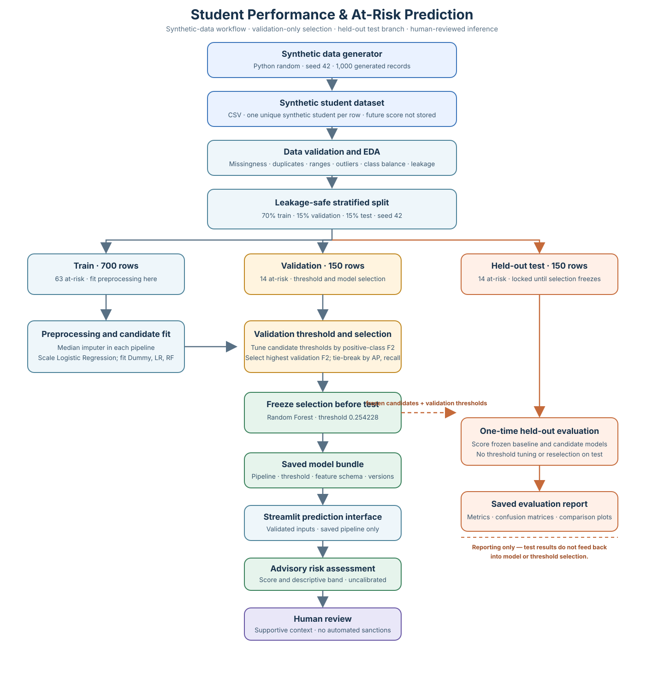
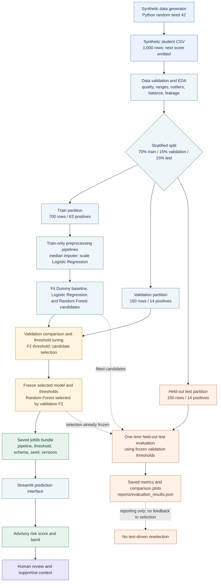

# System Architecture

The project has a training/evaluation path and a separate inference path. The test set enters only after model and validation-threshold selection are frozen; test results flow to reporting and have no path back to selection.

## Mermaid source

## Flow notes

- The data generator writes a future-score-derived binary label but omits that future score from the predictor columns.
- The five-feature allowlist excludes `student_id` and `at_risk`. The current generator creates one unique record per synthetic student, supporting stratified independent-row splitting.
- Pipelines fit imputation and (for Logistic Regression) scaling on training rows. Validation is used to tune candidate thresholds and choose the model using F2.
- The final Random Forest and its validation threshold are persisted before test evaluation. The frozen model candidates and their validation thresholds are evaluated on the held-out test partition once for the report. The test branch has no selection feedback.
- Inference loads the persisted artifact; it does not call the training path. The final output is advisory and requires human review.
