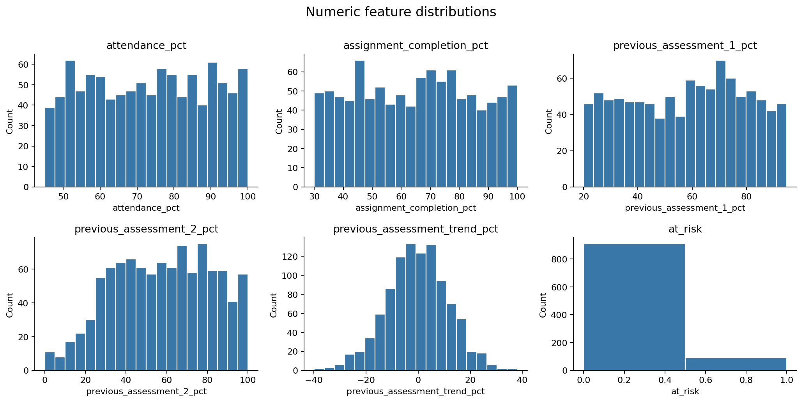
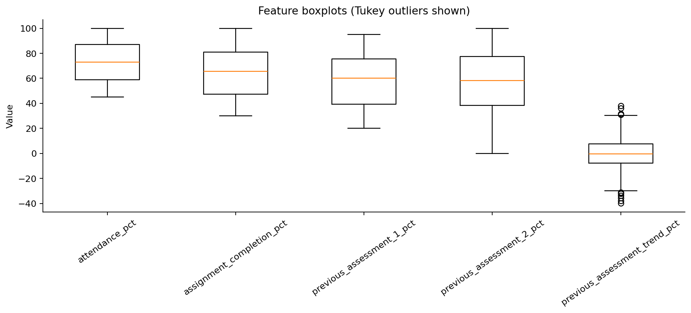
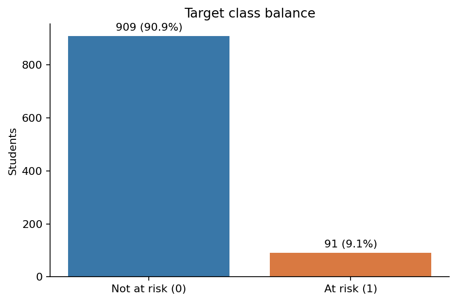
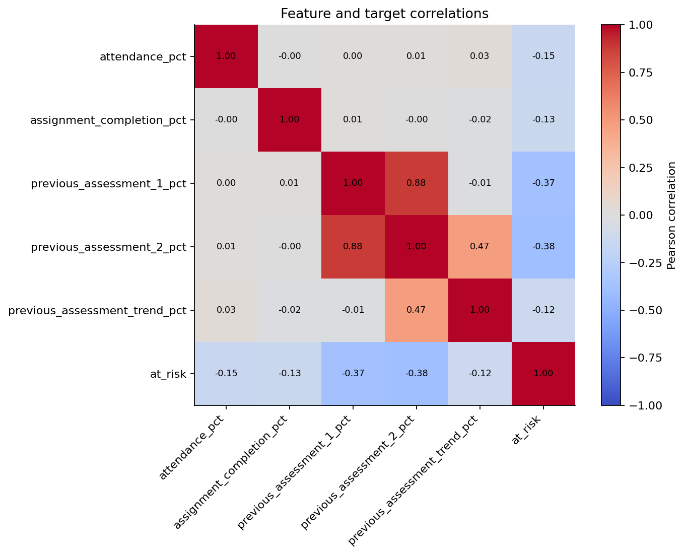
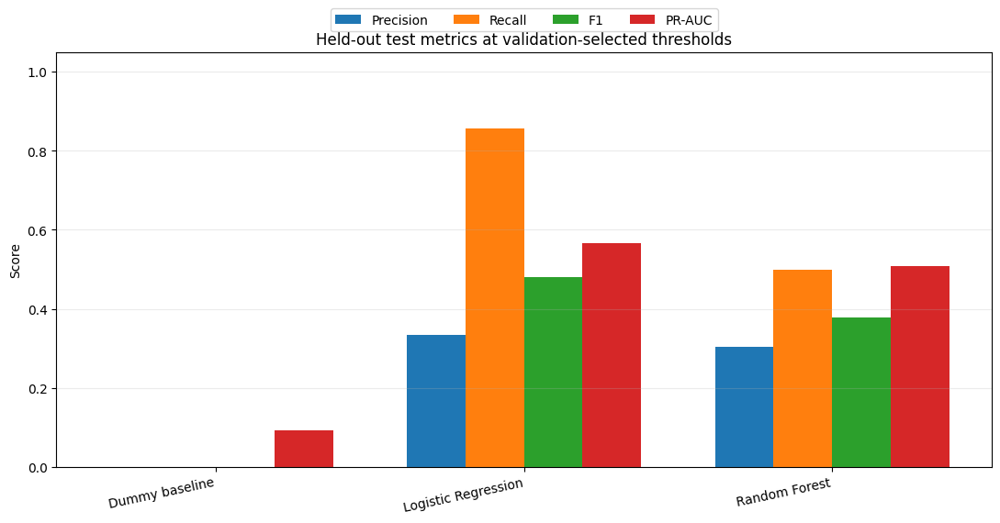
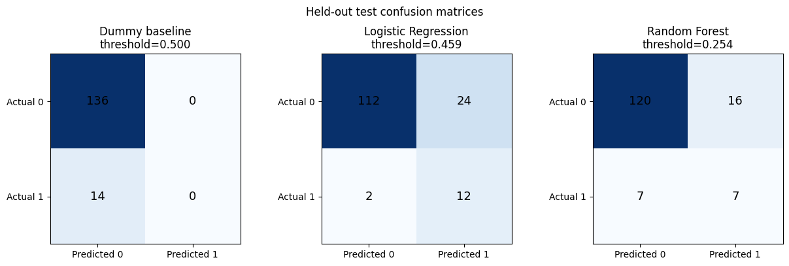

# Student Performance & At-Risk Prediction

## Technical Report

**ALGIONS AI LABS PRIVATE LIMITED**  
**Internship role:** AI & Machine Learning  
**Candidate:** Rohit Singh Danu  
**Registration number:** 12326149  
**Project status:** Synthetic-data prototype and advisory inference dashboard

---

## 2. Abstract and Executive Summary

This project demonstrates a reproducible workflow for identifying synthetic student records whose next simulated assessment score falls below 40%. A seeded Python generator creates 1,000 records. Exploratory analysis checks the schema, missingness, duplicates, percentage ranges, IQR outliers, class balance, feature relationships, and the target timeline. An explicit predictor allowlist excludes the student identifier and the binary target. The modeling workflow compares a prior-probability DummyClassifier, class-weighted Logistic Regression, and class-weighted Random Forest using a stratified 70/15/15 train/validation/test split.

Random Forest was selected before test evaluation because its validation F2 was 0.662651, slightly above Logistic Regression's 0.659341. Its validation-selected threshold is 0.2542277598. On the held-out test split, however, Logistic Regression had higher recall, F1, F2 and average precision, and fewer false negatives; this test result is reported but does not change the pre-test selection. The test set contains only 14 positive cases, so the comparison is uncertain. The generated data and labels are synthetic and do not establish performance on real students. The Streamlit app loads the saved pipeline and threshold and presents results as advisory signals for human review; its scores are not calibrated probabilities.

## 3. Introduction and Business Problem

Academic early-warning systems use available indicators to identify learners who may benefit from timely support. The What Works Clearinghouse guide on early-warning indicators discusses screening, local indicator choice, and intervention, while noting that indicator strength can vary by context [1]. This project is a small technical demonstration of that decision-support pattern; it is not a validated school intervention or a real-student risk assessment.

The prototype's intended use is to prompt a supportive, human-reviewed check-in. A model score should not replace an educator's knowledge of a student's circumstances. The application's visible notice states that predictions are advisory only and must not determine punishment, grades, or admissions.

| Design item | Definition in this project |
|---|---|
| Prediction unit | One generated row for one synthetic student; each student ID is unique. |
| Prediction point | After the two prior assessment scores and before the next assessment. |
| Prediction horizon | The student's next simulated assessment. |
| Target | `at_risk = 1` when the next simulated assessment score is strictly below 40%; otherwise 0. |
| Operational interpretation | A score at or above the saved threshold is a prompt for human review, not an automatic action. |

The dataset contains no timestamp or real assessment schedule. “Before the next assessment” is the generator's documented chronology, not an independently observed collection-time guarantee. In a real deployment, timestamps and data collection procedures would need confirmation.

## 4. Dataset Description and Data Generation

### 4.1 Source and generation method

The project does not download an external student dataset. `src/data/generate_data.py` uses Python's standard-library pseudo-random generator with a default seed of 42 to produce 1,000 synthetic records. Reusing a seed supports reproducible sequences within the documented runtime; Python notes that most generator algorithms can change across versions, which is one reason the report records the training environment [2].

For each row, attendance is sampled uniformly from 45–100%, assignment completion from 30–100%, and assessment 1 from 20–95%, with values rounded to one decimal place. Assessment 2 is assessment 1 plus Gaussian noise with standard deviation 12, clipped to 0–100% and rounded to one decimal. Trend is assessment 2 minus assessment 1, rounded to one decimal. The label-only next score is calculated as:

> next score = 0.40 × assessment 2 + 0.25 × attendance + 0.20 × assignment completion + 0.15 × assessment 1 + Gaussian noise (standard deviation 10)

The generated next score is clipped to 0–100. It is used to define `at_risk`, but is not written to the CSV. This makes the label reflect a known simulation formula rather than observed educational outcomes.

### 4.2 Schema and observed ranges

The current CSV has 1,000 rows and seven columns. All 1,000 student IDs are unique. Percentage columns are floating-point values; the target is an integer; IDs are strings.

| Column | Meaning | Type | Observed minimum–maximum |
|---|---|---:|---:|
| `student_id` | Synthetic row identifier | string | S00001–S01000 |
| `attendance_pct` | Attendance percentage | float | 45.0–100.0 |
| `assignment_completion_pct` | Assignment completion percentage | float | 30.0–100.0 |
| `previous_assessment_1_pct` | First prior assessment percentage | float | 20.0–94.9 |
| `previous_assessment_2_pct` | Second prior assessment percentage | float | 0.0–100.0 |
| `previous_assessment_trend_pct` | Assessment 2 minus assessment 1 | float | −39.8–38.0 |
| `at_risk` | 1 if simulated next score is below 40%; else 0 | integer | 0–1 |

The generator's bounds and observed sample extrema are not the same for every field. For example, assessment 1 is sampled from a range ending at 95%, but its observed maximum in this seeded sample is 94.9%.

### 4.3 Privacy, licensing, and representativeness

The CSV contains generated values and synthetic IDs, not records from identifiable students. No demographic or other sensitive attributes are generated. The repository contains no separate dataset attribution or LICENSE file. The CSV was generated by the repository's own code and no third-party dataset source is identified; the absence of a repository license means this report does not assign a license to the project or its generated data. Third-party libraries retain their respective upstream licenses.

The data do not represent a defined institution, course, age group, or population. Uniformly sampled inputs and a hand-specified score equation do not model the complexity, measurement practices, missingness, or social context of actual education data. The results must not be generalized to real students.

## 5. Exploratory Data Analysis

The executed notebook is `notebooks/eda.ipynb`. It reads the existing CSV and saves the figures referenced below under `reports/figures/`.

### 5.1 Data quality, ranges, and outliers

There are **0 missing cells**, **0 exact duplicate rows**, and **0 duplicate IDs**. Each percentage feature is within 0–100%; trend is within its logical −100–100 bound. The stored trend matched the rounded difference between the two prior assessment values in every row under the notebook's 0.11-point tolerance.

The notebook used Tukey's 1.5 × IQR rule as an outlier flag, not as a deletion rule. It flagged **10 trend values (1.0%)** and none of the other numeric predictors. For trend, the observed IQR fences were −30.375 and 30.225. No flagged observation was removed.

### 5.2 Descriptive statistics

| Feature | Mean | Standard deviation | Median | Observed range |
|---|---:|---:|---:|---:|
| Attendance (%) | 72.9316 | 15.8705 | 73.1 | 45.0–100.0 |
| Assignment completion (%) | 64.7235 | 20.0163 | 65.45 | 30.0–100.0 |
| Previous assessment 1 (%) | 58.0954 | 21.2991 | 60.15 | 20.0–94.9 |
| Previous assessment 2 (%) | 57.8429 | 24.1669 | 58.25 | 0.0–100.0 |
| Assessment trend (points) | −0.2525 | 11.6974 | −0.3 | −39.8–38.0 |

### 5.3 Class balance and correlations

The target distribution is **909 not-at-risk (90.9%)** and **91 at-risk (9.1%)**. This positive-class minority is relevant to both model training and interpretation of test estimates.

The saved notebook's Pearson correlations with the binary target are negative for every feature: previous assessment 2 −0.383842, previous assessment 1 −0.367642, attendance −0.145363, assignment completion −0.132350, and trend −0.123602. Previous assessment 1 and 2 are strongly correlated with each other (0.8751); trend is mathematically derived from these scores and correlates 0.4726 with assessment 2. These are descriptive, sample-specific associations, not causal effects.

## 6. Data Preprocessing and Feature Engineering

The training feature schema, in order, is attendance, assignment completion, assessment 1, assessment 2, and assessment trend. `student_id` is an identifier and is excluded. `at_risk` is the target and is excluded from X. The future next score is not stored in the CSV and is never included as a predictor. The audit also rejects extra columns with names suggesting future or target-derived information.

The assessment trend is stored in the training CSV as assessment 2 minus assessment 1. The Streamlit form accepts the four raw measures and derives the fifth feature as `round(assessment_2 − assessment_1, 1)`, matching the generator. Inputs are range-checked before prediction.

A median `SimpleImputer` is placed inside the preprocessing pipeline for all models. Logistic Regression additionally uses a `StandardScaler`; Random Forest does not require scale normalization. These transformers are fitted as part of each pipeline using only the training partition. The current EDA found no missing values, so median imputation did not need to fill a value in the current CSV; retaining it makes the fitted preprocessing behavior explicit.

The generator creates one independent row per unique synthetic student, so the model script uses a fixed-seed stratified split rather than a grouped or time-ordered split. The split is 70% train, 15% validation, and 15% test: 700/150/150 rows. At-risk counts are 63/14/14, respectively. The split uses seed 42 and `train_test_split(..., stratify=y)` [3]. If future data contain repeated observations, students must be kept together or time order respected; a random row split would then risk leakage.

## 7. Machine Learning Methodology

Three pipelines are compared:

1. **DummyClassifier (`strategy="prior"`)**: ignores predictors and returns the training-set class prior as its positive score. Its fixed 0.5 decision rule predicts no positives here because the positive class is below 50%. It is a reference baseline, not a support strategy [4].
2. **Logistic Regression**: median imputation, standard scaling, and `class_weight="balanced"`, with `max_iter=2000` and seed 42.
3. **Random Forest**: median imputation and a 300-tree classifier with `min_samples_leaf=2`, `class_weight="balanced"`, seed 42, and one job.

The `Pipeline` and `ColumnTransformer` design keeps transformations fitted with the estimator on training data [5]. Class weighting is used for both predictive candidates to account for the minority label; it does not create additional positive examples and does not guarantee good recall or calibrated scores.

For Logistic Regression and Random Forest, candidate thresholds are evaluated on validation probabilities. The threshold maximizing positive-class F2 is selected; ties are resolved by recall, then precision, then the higher threshold. F2 uses β=2, which places more emphasis on recall than precision. Model selection then compares candidate validation F2, breaking a tie by validation average precision and then recall. The DummyClassifier retains threshold 0.5. Test labels are not consulted for model or threshold selection.

The selected result is Random Forest with validation F2 **0.662651** at threshold **0.2542277598**. Logistic Regression had validation F2 **0.659341** at threshold **0.4588244374**. The selection margin is small (about 0.00331 F2), so it should not be interpreted as decisive evidence of population-level superiority.

## 8. Model Evaluation and Comparison

Precision, recall, F1 and F2 are evaluated for the positive `at_risk` class. PR-AUC in the saved results is scikit-learn's **average precision**: a non-interpolated weighted sum over precision-recall operating points, not trapezoidal area under a linearly interpolated curve [6]. Results below are copied from `reports/evaluation_results.json` and `reports/test_metrics.csv`; metric values are shown to six decimal places to preserve the saved precision.

### 8.1 Validation results

| Model | Threshold | Precision | Recall | F1 | F2 | PR-AUC / average precision | TN | FP | FN | TP |
|---|---:|---:|---:|---:|---:|---:|---:|---:|---:|---:|
| Dummy baseline | 0.500000 | 0.000000 | 0.000000 | 0.000000 | 0.000000 | 0.093333 | 136 | 0 | 14 | 0 |
| Logistic Regression | 0.458824 | 0.342857 | 0.857143 | 0.489796 | 0.659341 | 0.543326 | 113 | 23 | 2 | 12 |
| **Random Forest (selected)** | **0.254228** | **0.407407** | **0.785714** | **0.536585** | **0.662651** | **0.527381** | **120** | **16** | **3** | **11** |

### 8.2 Held-out test results

| Model | Validation-selected threshold | Precision | Recall | F1 | F2 | PR-AUC / average precision | TN | FP | FN | TP |
|---|---:|---:|---:|---:|---:|---:|---:|---:|---:|---:|
| Dummy baseline | 0.500000 | 0.000000 | 0.000000 | 0.000000 | 0.000000 | 0.093333 | 136 | 0 | 14 | 0 |
| Logistic Regression | 0.458824 | 0.333333 | 0.857143 | 0.480000 | 0.652174 | 0.566222 | 112 | 24 | 2 | 12 |
| **Random Forest (selected)** | **0.254228** | **0.304348** | **0.500000** | **0.378378** | **0.443038** | **0.507179** | **120** | **16** | **7** | **7** |

### 8.3 Selection and test interpretation

Random Forest was selected **using validation F2 before the held-out test evaluation**. Its validation F2 of 0.662651 exceeded Logistic Regression's 0.659341, so the saved model and threshold remain Random Forest at 0.2542277598. The test result is a final estimate, not a new selection criterion; the model is not switched based on test performance.

Logistic Regression achieved better metrics on this particular test split: higher precision (0.333333 vs. 0.304348), recall (0.857143 vs. 0.500000), F1 (0.480000 vs. 0.378378), F2 (0.652174 vs. 0.443038), and PR-AUC (0.566222 vs. 0.507179). It found 12 of 14 positives (FN=2) at the cost of 24 false positives. Random Forest found 7 of 14 (FN=7) and produced 16 false positives. These observed differences can arise from the sampled rows, model inductive biases, and validation-selected operating points; this single test sample cannot establish that Logistic Regression will be better on future or real data. Test performance is reported for both models but does not alter selection.

## 9. Error Analysis

On the held-out test set, Random Forest misses **7 of 14 at-risk records** and flags **16 not-at-risk records**. A false negative is an at-risk synthetic label not flagged at the chosen threshold; in a real support workflow, an analogous miss might delay a helpful conversation. A false positive consumes time for staff review and may create unnecessary concern. The Dummy baseline flags no one, so it has 14 false negatives and zero true positives. Logistic Regression shows the opposite operating point on this test set: fewer false negatives but more false positives than Random Forest.

Recall matters in a supportive early-warning setting because missed students may not receive timely attention. However, maximizing recall without regard to precision can exceed staff capacity. Threshold choice is therefore a policy and resourcing decision as well as a statistical one. F2 made recall more influential during this prototype's validation selection, but it does not encode intervention costs or guarantee an appropriate operating point.

The test set contains 14 positive cases. One additional correctly detected positive would change recall by roughly 1/14, or 7.1 percentage points. Precision, recall, and confusion counts are consequently sensitive to a few records. Metrics should be interpreted with this small denominator and the 9.1% dataset prevalence in mind.

## 10. Explainable AI

The saved Random Forest exposes impurity-based feature importances. The values below are read from the persisted classifier; they sum to 1 and summarize how the fitted trees used each feature during training.

| Feature | Random Forest impurity importance |
|---|---:|
| Previous assessment 2 | 0.325529 |
| Previous assessment 1 | 0.312955 |
| Attendance | 0.130548 |
| Assessment trend | 0.120296 |
| Assignment completion | 0.110673 |

These values indicate model use, not causal effects or guaranteed usefulness on future data. Scikit-learn cautions that impurity importance is computed from training-set split statistics and can favor high-cardinality features [7]. Here the inputs are numeric and have differing unique counts; importance ranks should therefore be treated cautiously.

The inference page also performs a local, one-feature-at-a-time sensitivity check: it resets one submitted value to that feature's fitted training median, keeps the other submitted values fixed, and compares the Random Forest score. This is model-compatible and easy to inspect, but it is not SHAP, a causal effect, or a realistic intervention simulation. Features are correlated and interact in trees, so the isolated score changes need not add up to the current score.

The app displays the positive-class `predict_proba` score. No calibration study, calibration curve, or Brier-score analysis was performed. These scores are **uncalibrated** and should not be interpreted as the true probability that a real student will fail an assessment. The UI's Low/Moderate/High bands are descriptive thresholds derived from the saved decision threshold, not validated risk categories.

## 11. Streamlit Application

The app is in `app.py` and is divided into **Student Risk Prediction** and **EDA & Model Performance** pages.

On startup, it loads the trusted `reports/model_artifacts/at_risk_pipeline.joblib` bundle and `reports/evaluation_results.json`, then checks that model name, input schema, and threshold agree. Streamlit's `st.cache_resource` caches the loaded model bundle across reruns [8]. The app does not call model fitting or dataset generation. The prediction form collects attendance, assignment completion, and the two prior assessment scores; it validates the ranges and derives the trend to match training. The saved preprocessing pipeline and Random Forest generate the positive-class score. The saved decision threshold is 0.2542277598. The UI maps a score below half the threshold to Low, from half-threshold up to (but excluding) the threshold to Moderate, and at or above threshold to High.

The performance page displays the saved validation and test metrics, class distribution, model comparison, test confusion matrix, feature distributions, and correlation chart. It reads stored results rather than recalculating or refitting a model. The app prominently requires human review and prohibits use for punishment, grades, or admissions. No student name or identifier is requested; the app code does not persist individual form submissions. Hosting infrastructure may have its own logs and retention, which must be reviewed before remote use.

The model is serialized with joblib. Joblib persistence is pickle-based; loading a bundle from an untrusted source can execute code. Only load the project artifact from a trusted, controlled source [9]. Scikit-learn also documents that loading persisted estimators across library versions is unsupported. Version compatibility should be preserved when deploying this artifact.

## 12. Testing and Reproducibility

### 12.1 Environment recorded with the model

The saved evaluation metadata records Python **3.9.6**, NumPy **1.26.4**, pandas **2.3.3**, scikit-learn **1.6.1**, joblib **1.5.3**, and Matplotlib **3.9.4**. The environment used for this report also has Streamlit **1.50.0**; Streamlit is not recorded in the model-training metadata. `requirements.txt` specifies compatible version ranges rather than an exact lockfile, and the repository contains no lockfile. For dependable joblib loading and byte-for-byte reproduction, recreate the saved training versions; scikit-learn warns that cross-version model loading is unsupported [9].

The EDA notebook includes executed outputs. Its documented `jupyter nbconvert` command could not be run in the earlier analysis environment because the `jupyter-nbconvert` command was unavailable. Jupyter/nbclient/ipykernel are not listed in `requirements.txt`; a fresh environment therefore needs notebook tooling installed separately to execute the notebook. The recorded EDA outputs and figures are already included in the repository.

### 12.2 Commands

From the project root, install the project's declared runtime dependencies and launch the dashboard:

    python -m pip install -r requirements.txt
    streamlit run app.py

The following commands reproduce the synthetic CSV and model evaluation when intentionally rebuilding the experiment. They overwrite generated outputs at their default paths, so use a copy of the project when preserving this submission's existing artifacts:

    python -m src.data.generate_data --records 1000 --seed 42
    python -m src.models.train --seed 42

The notebook can be executed in an environment with Jupyter and nbconvert installed:

    jupyter nbconvert --to notebook --execute notebooks/eda.ipynb --output eda.executed.ipynb

### 12.3 Automated checks and saved outputs

The complete automated test suite was run with `python3 -m unittest discover -s tests -v`: **16 tests passed**. Coverage includes generator schema/range/seed behavior; feature leakage, split reproducibility and saved inference; input validation and engineered trend; Streamlit prediction rendering; dashboard contrast; saved evaluation metric formatting/consistency; and performance-page rendering. The existing reproducibility test runs training twice into temporary directories; it did not overwrite the repository's saved model. Generation tests also write only to temporary files.

Saved project outputs include:

- Synthetic CSV: `data/processed/student_performance.csv`.
- EDA notebook: `notebooks/eda.ipynb`.
- Metrics and audit: `reports/evaluation_results.json` and `reports/test_metrics.csv`.
- Human-readable model report: `reports/model_evaluation.md`.
- Selected pipeline, schema, seed, threshold, and environment metadata: `reports/model_artifacts/at_risk_pipeline.joblib`.
- EDA and evaluation figures: files under `reports/figures/`.

## 13. Responsible AI and Limitations

- **Synthetic validity:** Labels are produced by a formula with known feature weights plus random noise. Success on this simulated outcome does not establish validity for educational decisions.
- **Bias and fairness:** No demographic or protected-group fields exist in the CSV, so subgroup performance, disparate error rates, and fairness cannot be evaluated. Synthetic feature generation is not a fairness guarantee.
- **Privacy:** The current CSV uses synthetic IDs and contains no real student records. Real educational records would require authorization, data minimization, secure handling, retention controls, and institutional/legal review before use.
- **Uncertainty:** Only 14 positive cases are in the test set. Metrics have high sampling uncertainty, and no confidence intervals or repeated external tests are included.
- **Calibration:** Model scores have not been calibrated. The dashboard's bands are not validated probabilities or action tiers.
- **Human oversight:** The app is advisory only. Do not use predictions to decide punishment, grades, admissions, or access to services. Any supportive follow-up needs context-sensitive human review and a process for correction or appeal.
- **Intervention value:** This project evaluates prediction against a synthetic label. It does not test whether an intervention prompted by a prediction improves a student's outcomes.

## 14. Future Improvements

1. Obtain properly licensed, authorized educational data and document provenance, consent/authority, permitted use, and retention.
2. Define the outcome horizon and prediction point with educators, then validate chronology and data availability.
3. Use institution-level, group-aware, or chronological external validation when data contain repeated learners or multiple schools.
4. Report uncertainty intervals and evaluate precision/recall tradeoffs against actual support capacity.
5. Assess probability calibration on sufficiently large, representative data before presenting probabilities.
6. Examine subgroup performance and fairness only where lawful, appropriate, and adequately powered; establish governance before use.
7. Monitor data and performance shifts, intervention outcomes, and model failure reports.
8. Improve explanations with held-out permutation importance or SHAP-style methods where appropriate, while retaining human-understandable limitations.
9. Pin the full runtime and notebook dependencies in a lockfile and add a dedicated notebook setup path.

## 15. Conclusion

The repository demonstrates the full path from seeded synthetic data through EDA, leakage-aware train/validation/test evaluation, a saved preprocessing/model pipeline, and an advisory Streamlit interface. The saved Random Forest remains the final model because it won the pre-test validation F2 comparison. Logistic Regression's stronger result on the small test split is reported as an observation, not used to reselect the model. The central conclusion is methodological: this is a reproducible prototype with a clear human-review boundary, not evidence that the model is ready for real student decisions.

## 16. References

1. Li, Y., Scala, J., Gerdeman, D., & Blumenthal, D. (2016). *District Guide for Creating Indicators for Early Warning Systems*. Regional Educational Laboratory West, Institute of Education Sciences, U.S. Department of Education. [Official IES resource](https://ies.ed.gov/use-work/resource-library/resource/other-resource/district-guide-creating-indicators-early-warning-systems).
2. Python Software Foundation. *random — Generate pseudo-random numbers*, including reproducibility notes. [Python documentation](https://docs.python.org/3/library/random.html).
3. scikit-learn developers. *train_test_split*. [API documentation](https://scikit-learn.org/stable/modules/generated/sklearn.model_selection.train_test_split.html).
4. scikit-learn developers. *DummyClassifier*. [API documentation](https://scikit-learn.org/stable/api/sklearn.dummy.html).
5. scikit-learn developers. *Pipeline and composite estimators*. [Pipeline API](https://scikit-learn.org/stable/modules/generated/sklearn.pipeline.Pipeline.html) and [composition guide](https://scikit-learn.org/stable/modules/compose.html).
6. scikit-learn developers. *average_precision_score*. [API documentation](https://scikit-learn.org/stable/modules/generated/sklearn.metrics.average_precision_score.html).
7. scikit-learn developers. *Ensemble methods and Random Forest feature importance*. [User guide](https://scikit-learn.org/stable/modules/ensemble.html).
8. Streamlit developers. *Caching overview* and *input widgets*. [Caching documentation](https://docs.streamlit.io/develop/concepts/architecture/caching) and [widgets documentation](https://docs.streamlit.io/develop/api-reference/widgets).
9. scikit-learn developers. *Model persistence*. [Persistence and security guidance](https://scikit-learn.org/stable/model_persistence.html); Joblib developers, [serialization documentation](https://joblib.readthedocs.io/en/stable/user_guide/persistence.html).
10. pandas developers. [pandas documentation](https://pandas.pydata.org/docs/); NumPy developers. [NumPy 1.26 documentation](https://numpy.org/doc/1.26/); Matplotlib developers. [Matplotlib documentation](https://matplotlib.org/stable/).

The dataset is generated by this repository's `src/data/generate_data.py`; it has no external dataset citation. Software versions above are read from the saved evaluation bundle, except Streamlit, which is the version present in the report-generation environment.
